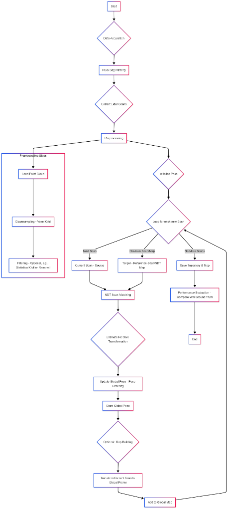
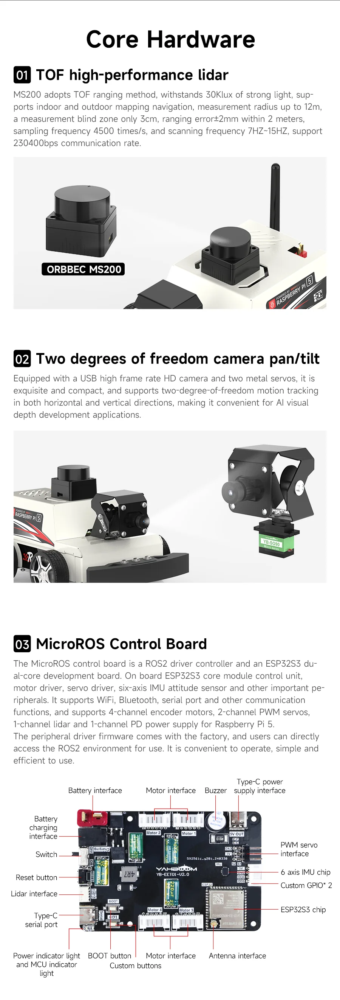
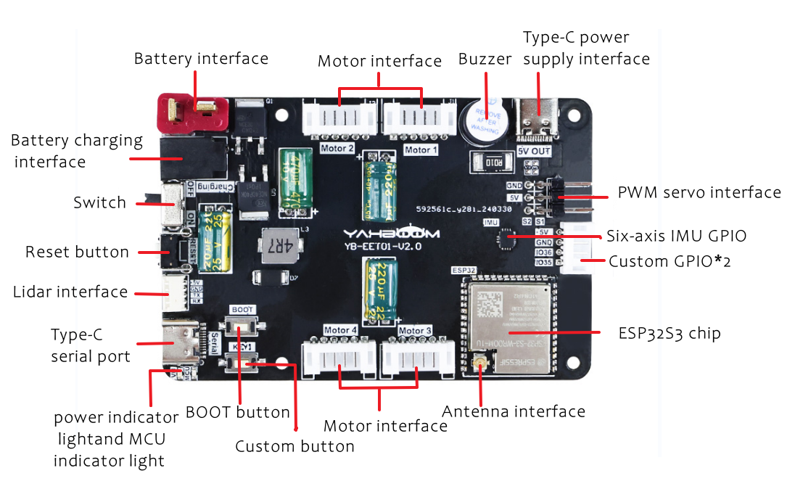
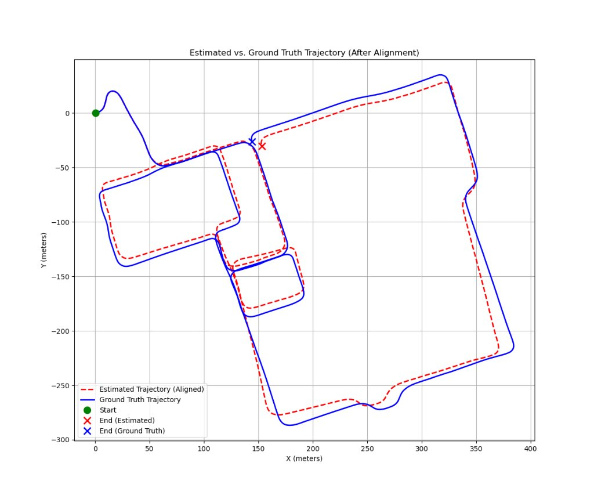
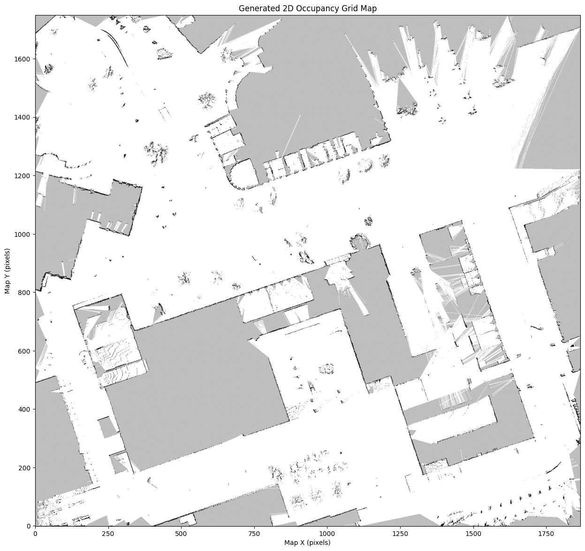
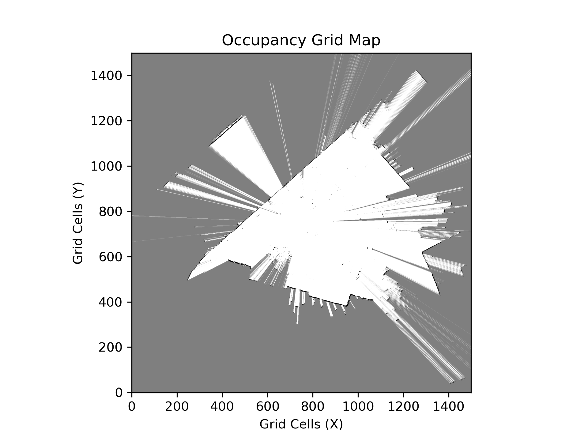

# LiDAR-based 2D/3D SLAM with ICP Odometry & Occupancy Grid Mapping

[](https://www.python.org/)
[](http://www.open3d.org/)
[](LICENSE)
[]()

> A robust, end-to-end Simultaneous Localization and Mapping (SLAM) pipeline using LiDAR point clouds, Point-to-Plane Iterative Closest Point (ICP) scan matching, trajectory evaluation against ground truth (ATE/RTE in TUM format), and log-odds 2D occupancy grid mapping. Developed in the context of autonomous navigation research at **U R Rao Satellite Centre (URSC), ISRO**.

---

## 📌 Table of Contents
- [Overview](#-overview)
- [System Architecture](#-system-architecture)
- [Key Features](#-key-features)
- [Repository Structure](#-repository-structure)
- [Hardware & Platform](#-hardware--platform)
- [Installation](#-installation)
- [Data Preparation](#-data-preparation)
- [Usage](#-usage)
  - [1. Dataset Mode (Batch Processing)](#1-dataset-mode-batch-processing)
  - [2. Live Simulation Mode](#2-live-simulation-mode)
  - [Command-Line Options](#command-line-options)
- [Experimental Results](#-experimental-results)
  - [Full SLAM Demonstration Video](#full-slam-run--visualization-video)
  - [Trajectory Evaluation](#trajectory-evaluation)
  - [2D Occupancy Grid Map](#2d-occupancy-grid-map)
- [Documentation & Research](#-documentation--research)
- [License & Acknowledgments](#-license--acknowledgments)

---

## 🚀 Overview

Simultaneous Localization and Mapping (**SLAM**) is the computational problem of constructing or updating a map of an unknown environment while simultaneously keeping track of an agent's location within it.

This project delivers a unified Python-based LiDAR SLAM implementation featuring:
1. **Front-End Odometry**: Point-to-Plane Iterative Closest Point (ICP) algorithm for scan matching.
2. **Back-End & Map Generation**: 3D point cloud accumulation and dense 2D occupancy grid mapping using inverse sensor models (log-odds representation).
3. **Trajectory Benchmarking**: Quantitative evaluation against ground truth trajectories using Absolute Trajectory Error (ATE) and Relative Trajectory Error (RTE) via Umeyama rigid alignment.

---

## 📐 System Architecture

<div align="center">
  
</div>

The end-to-end SLAM pipeline comprises the following core stages:
1. **Data Acquisition & ROS Bag Parsing**: Parsing raw packet streams and extracting synchronized 3D LiDAR point clouds.
2. **Preprocessing & Filtering**: Voxel grid downsampling and statistical outlier removal to accelerate correspondence search.
3. **Scan Matching & Pose Estimation**: Normal Distributions Transform (NDT) / Point-to-Plane ICP to estimate relative 6-DoF rigid transformations between consecutive scans.
4. **Pose Chaining & Map Integration**: Chaining transformations into a global trajectory and projecting scans into the global coordinate frame.
5. **Benchmarking & Output**: Rigorous trajectory evaluation against ground truth datasets (ATE / RTE) and export of 2D/3D maps.

---

## ✨ Key Features

* **Point-to-Plane ICP Odometry**: Fast and robust relative pose estimation between sequential scans with surface normal estimation and distance thresholding.
* **Dual Operation Modes**:
  * **Dataset Mode**: High-throughput batch processing for offline dataset benchmarking.
  * **Live Simulation Mode**: Simulates real-time incoming scan streams with live 3D visualization.
* **Full Trajectory Evaluation**: Evaluates estimated trajectories against ground truth (TUM format: `timestamp tx ty tz qx qy qz qw`) with automatic spatial alignment.
* **2D Log-Odds Occupancy Grid Mapping**: Projects 3D LiDAR point clouds into a 2D floor plan with configurable height filtering, log-odds cell updates, and dynamic map boundaries.
* **Modular Codebase & Notebooks**: Clean CLI entry point, standalone analysis scripts, and interactive Jupyter notebook for experimentation.

---

## 📂 Repository Structure

```text
├── assets/
│   ├── figures/                # Architectural diagrams, trajectories & grid maps
│   ├── hardware/               # Robot car & Micro-ROS hardware images
│   └── videos/                 # SLAM run visualization animations
├── docs/                       # Research papers, technical reports & presentations
│   ├── papers/                 # Relevant literature (e.g., NDT & ICP papers)
│   ├── matlab/                 # Legacy MATLAB occupancy grid implementations
│   ├── lidar_based_slam_report.pdf
│   └── SLAM_presentation.pptx
├── notebooks/
│   └── Grid_based_Mapping.ipynb# Interactive Jupyter notebook for 2D mapping
├── results/                    # Pre-computed trajectory files and evaluation results
│   ├── estimated_trajectory_icp_allscans.txt
│   └── estimated_trajectory_icp_2nd_dataset.txt
├── src/                        # Source code
│   ├── unified_slam.py         # Main unified SLAM CLI pipeline
│   ├── comparison.py           # Trajectory evaluation & error metrics
│   ├── grid_based_mapping.py   # Standalone 2D occupancy grid mapping
│   ├── all_scans_visualization.py # Multi-scan 3D visualization tool
│   └── icp_slam_100625.py      # Baseline ICP SLAM script
├── .gitignore                  # Git ignore rules for caches, venvs, and binaries
├── LICENSE                     # MIT License
├── README.md                   # Project documentation
└── requirements.txt            # Python dependencies
```

---

## 🤖 Hardware & Platform

This SLAM algorithm has been validated with datasets captured from real-world mobile robot setups, including a **Micro-ROS Raspberry Pi 5 Car** platform:

| Micro-ROS Mobile Platform | Micro-ROS Control Board |
| :---: | :---: |
|  |  |

---

## 🛠 Installation

### Prerequisites
* Python 3.8 or higher
* Recommended: Virtual environment (`venv` or `conda`)

### Setup
```bash
# Clone the repository
git clone https://github.com/<your-username>/LiDAR-based-2D-SLAM.git
cd LiDAR-based-2D-SLAM

# Create and activate a virtual environment
python -m venv venv
# On Windows:
venv\Scripts\activate
# On Linux/macOS:
source venv/bin/activate

# Install required dependencies
pip install -r requirements.txt
```

---

## 📊 Data Preparation

### 1. LiDAR Scan Files
The pipeline accepts LiDAR scans stored as timestamped CSV files inside a directory (e.g., `Combined_RVP_csv/`). Each CSV must contain `x`, `y`, and `z` coordinate columns:
```
x,y,z,intensity,...
0.542,1.231,-0.12,15
...
```
* Filename convention: `scan_<TIMESTAMP>.csv` (e.g., `scan_1571160010.123456789.csv`).

### 2. Ground Truth Trajectory (Optional for Evaluation)
Ground truth trajectories should be formatted using the **TUM format**:
```
# timestamp tx ty tz qx qy qz qw
1571160010.1234 0.000 0.000 0.000 0.000 0.000 0.000 1.000
```

---

## 💻 Usage

The primary entry point is `src/unified_slam.py`.

### 1. Dataset Mode (Batch Processing)
Processes all scans in a directory, runs trajectory alignment, saves maps, and generates evaluation plots:
```bash
python src/unified_slam.py --mode dataset \
                           --csv_dir /path/to/Combined_RVP_csv \
                           --gt_path /path/to/campus_train0_gt.txt \
                           --num_scans 1000
```

### 2. Live Simulation Mode
Simulates a real-time streaming LiDAR sensor with live 3D Open3D visualizer updates:
```bash
python src/unified_slam.py --mode live \
                           --csv_dir /path/to/Combined_RVP_csv \
                           --live_delay 0.05
```

### Command-Line Options

| Argument | Type | Default | Description |
| :--- | :--- | :--- | :--- |
| `--mode` | string | `dataset` | Execution mode: `dataset` (batch) or `live` (simulated stream). |
| `--csv_dir` | string | `Combined_RVP_csv` | Directory path containing LiDAR scan CSV files. |
| `--gt_path` | string | `campus_train0_gt.txt`| Path to ground truth trajectory file (TUM format). |
| `--num_scans` | int | `None` | Max number of scans to process (processes all if omitted). |
| `--live_delay` | float | `0.1` | Delay in seconds between scans in live simulation mode. |
| `--no_eval` | flag | `False` | Skip trajectory evaluation against ground truth. |
| `--no_3d_vis` | flag | `False` | Skip Open3D 3D point cloud visualization window. |
| `--no_2d_anim` | flag | `False` | Skip 2D trajectory animation display. |
| `--no_grid_map`| flag | `False` | Skip 2D occupancy grid map generation. |
| `--save_anim_video` | flag | `False`| Save 2D trajectory animation as a GIF file. |

---

## 🔬 Experimental Results

### Full SLAM Run & Visualization Video

The video below demonstrates real-time scan matching, 3D point cloud accumulation, and live 2D occupancy grid updates across the entire test dataset:

<div align="center">
  <video src="assets/videos/full_slam_visualization.mp4" width="85%" controls="controls">
    Your browser does not support the video tag.
  </video>
  <p><em>🎥 <a href="assets/videos/full_slam_visualization.mp4"><strong>Click here to open / download the full SLAM visualization video (assets/videos/full_slam_visualization.mp4)</strong></a></em></p>
</div>

### Trajectory Evaluation
Comparison between the ICP-estimated trajectory and the ground truth trajectory demonstrates high tracking fidelity over extended multi-loop campus trajectories:

<div align="center">
  
</div>

### 2D Occupancy Grid Map
The log-odds inverse sensor model successfully reconstructs walls, corridors, and obstacle boundaries:

| High-Resolution Occupancy Grid | Inverted Occupancy Map |
| :---: | :---: |
|  |  |

---

## 📚 Documentation & Research

Detailed project presentations and academic research documents are provided in the [`docs/`](docs/) directory:
* [LiDAR SLAM Comprehensive Technical Report (PDF)](docs/lidar_based_slam_report.pdf)
* [SLAM Presentation Slides (PPTX)](docs/SLAM_presentation.pptx)
* [Normal Distributions Transform (NDT) Literature Review](docs/papers/the_normal_distributions_transform_paper.pdf)
* [MATLAB Prototype Scripts](docs/matlab/)

---

## 📜 License & Acknowledgments

* **License**: Distributed under the [MIT License](LICENSE).
* **Research Context**: Developed during research affiliated with the **U R Rao Satellite Centre (URSC), Indian Space Research Organisation (ISRO)**.

